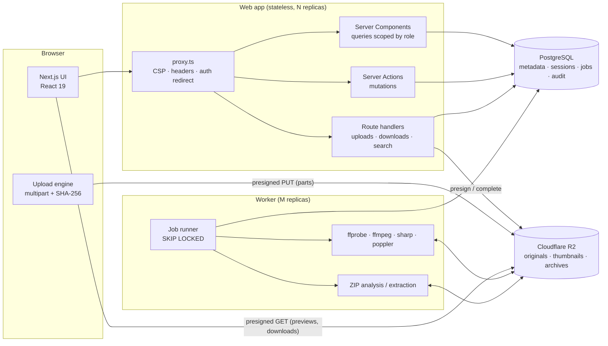
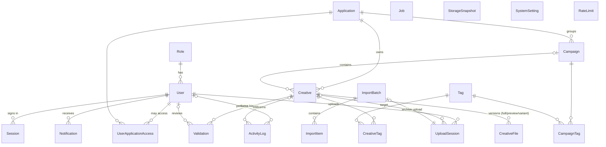
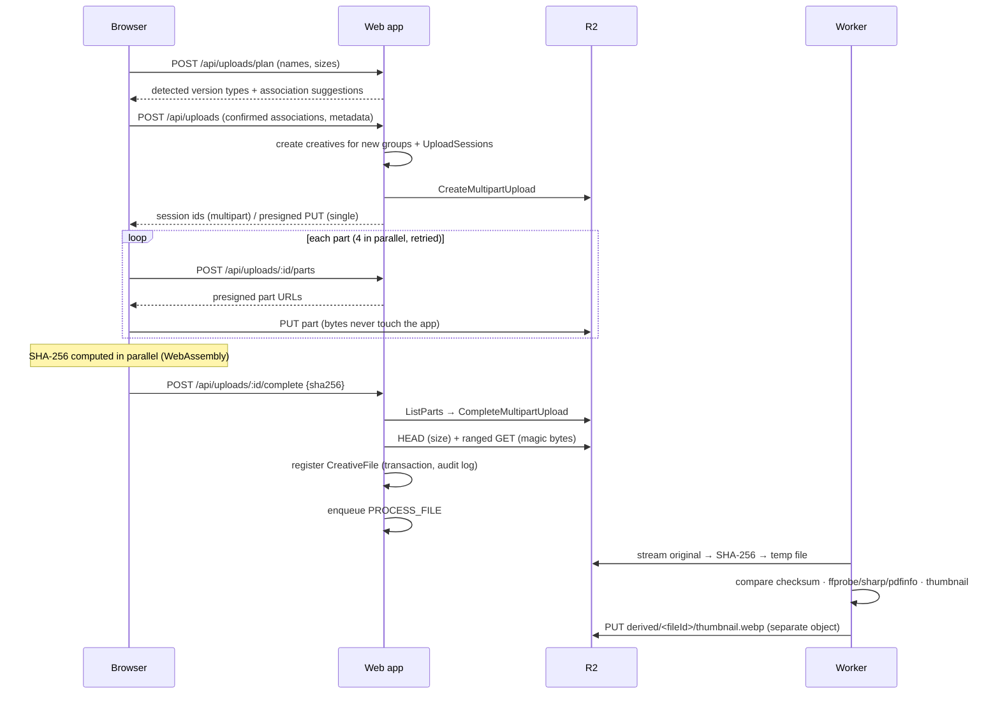
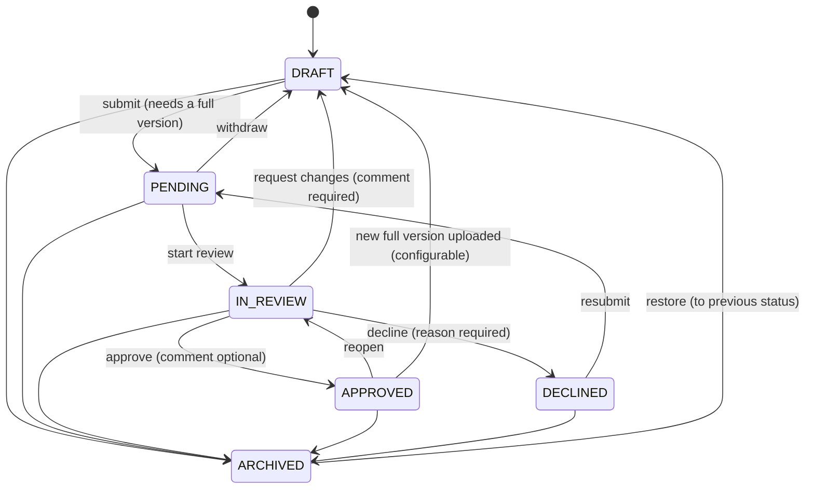

# Architecture

## 1. Overview

- **One codebase, two processes.** The web app renders pages and handles mutations; the worker runs everything slow or binary-heavy. Both import the same service layer (`src/server/services`, `src/lib`).
- **Files never flow through the web servers.** Browsers upload to and download from R2 with short-lived presigned URLs. The app only authorises and signs requests.
- **PostgreSQL is the system of record** for metadata, permissions, sessions, rate limits, the job queue and the audit log. No Redis or extra infrastructure is required.

### Key decisions

| Decision | Rationale |
|---|---|
| Next.js App Router, **dynamic rendering** (`cacheComponents: false`) | Every screen is per-user and permission-scoped, so there is no meaningful static shell. Classic dynamic rendering avoids Suspense-boundary constraints and keeps data fresh. |
| **Database sessions** instead of JWT/Auth library | Instant revocation (disable user, role change, password change), no beta dependency, tokens stored only as SHA-256 hashes. |
| **Postgres job queue** | One less moving part; `FOR UPDATE SKIP LOCKED` gives safe concurrency across replicas; jobs are inspectable (Settings → System status). |
| **Direct-to-R2 multipart uploads** | Supports multi-GB masters, parallel parts, resume, and zero bandwidth cost on the app tier. |
| **File-level library rows** | One row per current full version, plus preview rows when enabled. Previews are hidden by default yet listable and labelled, and "largest files" sorting is a single indexed query. |
| **Permission matrix in code** | Versioned and reviewed; the `Role` table holds role metadata only. All list, detail, statistics and search queries go through `creativeVisibilityWhere()`. |

## 2. Data model

| Model | Purpose / notable constraints |
|---|---|
| `Creative` | Logical asset: name, application (required), campaign, category, status, channels, keywords, `matchKey`. Indexes on `(applicationId,status)`, `(applicationId,matchKey)`, status/updatedAt, plus a trigram GIN index on `name`. |
| `CreativeFile` | One stored object: `versionType`, `versionNumber` (unique per creative+type), `isCurrent`, original filename, `storageKey` (unique), size (BigInt), MIME, resolution, duration, codecs, page count, browser checksum, worker-verified checksum, integrity and processing status, thumbnail/display keys. Trigram index on `originalFilename`. Cascade-deleted with its creative. |
| `Validation` | Immutable transition record: from/to status, action, reviewer, comment, decline reason, the file version reviewed. |
| `ActivityLog` | Audit trail with a human-readable summary kept even after entities are deleted (`SetNull` foreign keys), plus metadata, IP and user agent. |
| `UploadSession` | Direct upload state: mode, R2 upload id, part size/count, fingerprint (for resume), target creative, and the pre-reserved file id. |
| `ImportBatch` / `ImportItem` | ZIP import with per-entry validation result, suggestions, the user's decisions and the outcome. |
| `Job` | Queue: type, JSON payload, attempts, backoff (`runAt`), lock/heartbeat. |

Media binaries are never stored in PostgreSQL. Sizes use `BigInt` (masters can exceed 2 GiB). Migrations live in `prisma/migrations` (the first enables `pg_trgm`).

## 3. Upload pipeline

- **Resume:** the session fingerprint (name + size + lastModified) lets the user re-select the same file after a crash; R2's `ListParts` is the source of truth for which parts exist.
- **Cancel:** aborts the R2 multipart upload and removes the creative if it ended up empty.
- **Validation:** extension allow-list, size limit (env cap and admin setting), stored size equals declared size, and magic bytes must match the declared type. Mismatches are deleted and rejected.
- **Quality preservation:** originals are written once and never rewritten. Derived assets live under `derived/`.

Object keys use immutable ids (`originals/<app>/<creative>/<file>/<safe-name>`), so renames never move objects.

## 4. Full / preview matching

1. `parseFilename()` detects a trailing `_preview` (case-insensitive) and computes a `matchKey`: the base name without extension or suffix, normalised (lower-case, accents and separators folded).
2. `planAssociations()` groups files by `(application, matchKey)` and decides:

| Situation | Result |
|---|---|
| One full + its preview in the same batch | One new creative; the preview follows the full file |
| Only a preview, no existing match | New *preview-only* creative (hidden from the library, shown as "Unmatched preview") |
| A full whose only match is a preview-only creative | Completes that creative automatically |
| A preview with exactly one existing match | Attached to it (shown, changeable) |
| Several candidates, or a full colliding with a creative that already has a full version | **User must decide**; upload/import is blocked until resolved |

Matching never crosses applications, never relies on filenames alone (the link is the `Creative ↔ CreativeFile` relation), and every automatic association is displayed with its reason before upload.

## 5. Validation workflow

Approving or declining straight from `PENDING` records an explicit `REVIEW_STARTED` step first, so the history always shows the canonical path. Each transition locks the creative row and writes the `Validation` row, the audit log entry and the notifications in one transaction.

## 6. Security model

| Concern | Implementation |
|---|---|
| Authentication | argon2id (19 MiB, t=2); 256-bit random session tokens stored as SHA-256; httpOnly, `SameSite=Lax`, `Secure` cookies; sliding expiry; temporary passwords force a change at first sign-in |
| Authorisation | `requireUser` / `requireActionUser` / `apiUser` on every page, action and route; resource-level checks (`canEditCreative`, `canReviewCreative`…); query scoping via `creativeVisibilityWhere()`; inaccessible resources return 404 |
| CSRF | Server Actions' built-in origin check; route handlers require same-origin `Origin`/Fetch-Metadata for mutations |
| Rate limiting | Postgres-backed fixed windows: failed sign-ins per account (and per IP when `TRUST_PROXY`), uploads, search, downloads, exports |
| Headers | Per-request CSP nonce (`script-src 'nonce' 'strict-dynamic' 'wasm-unsafe-eval'`), `frame-ancestors 'none'`, HSTS, nosniff, Referrer-Policy, Permissions-Policy, COOP |
| Storage | Private bucket; credentials only on the server; presigned URLs scoped to one object/part and short-lived (downloads 5 min) |
| Uploads | Extension allow-list, size limits, stored size check, magic-byte sniffing, checksum verification |
| ZIP imports | Own name validation (no `..`, absolute or drive paths, control chars), symlink/encryption rejection, entry count and total size caps, compression-ratio check, yauzl size validation, content sniffing per entry; entries are streamed to generated keys and never written to disk by archive path |
| Audit | Activity log for sign-ins (including failures), uploads, edits, status changes, downloads, deletions, user and settings changes; CSV export with formula-injection escaping |
| Secrets | Environment variables only, validated with Zod; never logged or displayed |

## 7. Risks and mitigations

| Risk | Mitigation |
|---|---|
| Multi-GB uploads over unstable networks | Multipart with parallel parts, per-part retries, resume from R2 `ListParts`, 48 h session TTL with automatic cleanup |
| Browser cannot play some containers or codecs | Graceful fallback to poster + download; `_preview` versions are usually MP4/H.264 |
| Worker downtime | Uploads still succeed; jobs queue up, retry with backoff, recover stale locks; Settings shows a stalled-queue warning |
| Storage growth beyond the free tier | Storage page with per-application/category usage, threshold warning, cost estimate, reconciliation for orphans |
| Name-based matching linking unrelated files | Matching scoped to application; ambiguous cases require explicit decisions; files can be moved/linked later; every link is audited |
| Malicious archives / disguised files | See security model; rejected entries are listed with reasons |
| Approved status drifting from content | New full version resets approval (configurable); the approved version is recorded and highlighted |
| Lost database records vs. bucket | Reconciliation detects missing originals and orphan objects |

## 8. Performance notes

- Library queries hit indexed columns; text search uses trigram GIN indexes on creative names and filenames, with all tokens AND-ed.
- Thumbnail URLs are signed with an hour-bucketed signing date so identical URLs are produced for an hour and cached by browsers.
- Grids load small WebP thumbnails (≤ 640 px) lazily; originals are only requested by the viewer.
- No full-table loads in the browser: pagination everywhere (library, activity, notifications), and aggregations run in SQL.
